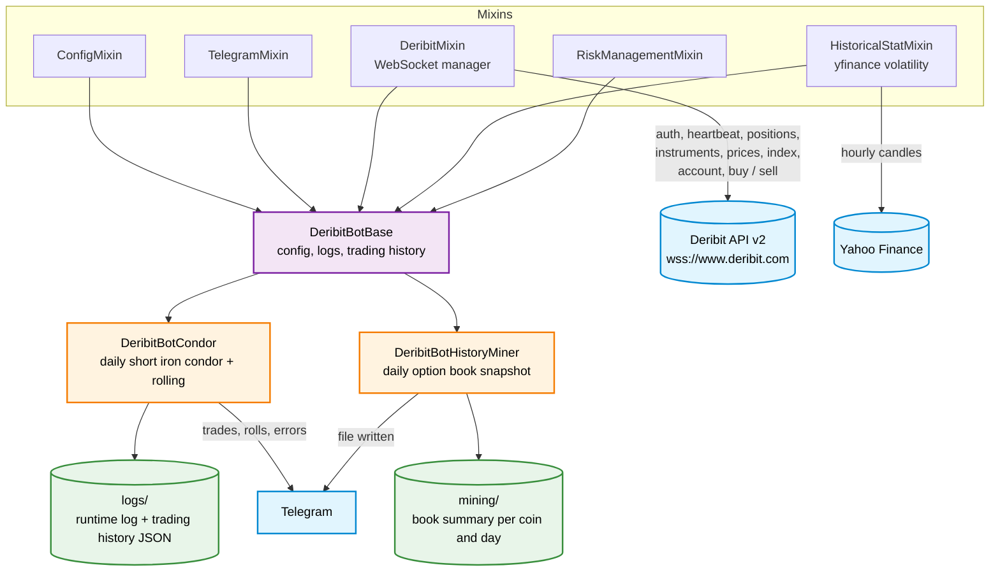

# Deribit options bots


Two bots for crypto options on [Deribit](https://www.deribit.com), built on one
shared base class:

- **Condor bot** — every day opens a short iron condor on the next-day options
  (ETH by default) and rolls the tested side when the price runs through a short
  strike.
- **History miner** — once a day saves a snapshot of the option order books for
  later analysis.

## Architecture



## Repository layout

```
start_deribit_bot_condor.py        — runs DeribitBotCondor
start_deribit_bot_history_miner.py — runs DeribitBotHistoryMiner
deribit_bot_v5.ipynb               — runs the condor bot from Jupyter
requirements.txt                   — full environment freeze (UTF-16, includes conda paths)
modules/
  deribit_bot_base.py              — DeribitBotBase: combines the mixins, sets up logs, loads trading history
  deribit_bot_condor.py            — DeribitBotCondor: strike selection, condor pricing, sizing, trading, rolling
  deribit_bot_history_miner.py     — DeribitBotHistoryMiner: writes the daily option book snapshot
  mixins/
    config_mixin.py                — loads config/config.yaml, get_config_value(*keys)
    deribit_mixin.py               — async WebSocket session: auth/refresh, heartbeat, subscriptions, buy/sell
    historical_stat_mixin.py       — hourly history from Yahoo Finance, candle body mean/median/EWM, historical volatility
    risk_management_mixin.py       — risk check interface
    telegram_mixin.py              — send_telegram_message()
config/
  config.yaml                      — version, log level, trading windows (UTC), per-coin scenarios, risk limits, paths
  deribit_config.yaml              — API URLs and key, coins, message ids
  historical_stat_config.yaml      — Yahoo Finance ticker, period, interval, volatility window
  telegram_config.yaml             — Telegram chat and bot token
```

## Secrets

The configs in this repository contain placeholders instead of real values:

- `config/deribit_config.yaml`: `YOUR_DERIBIT_CLIENT_ID`, `YOUR_DERIBIT_CLIENT_SECRET`
  (an API key with trading rights from Deribit account settings);
- `config/telegram_config.yaml`: `YOUR_TELEGRAM_BOT_TOKEN`.

Fill them in on the machine the bot runs on and do not commit the filled-in
files.

## How it works

### Shared base

`DeribitMixin.ws_manager()` keeps one WebSocket connection to Deribit API v2. It
authenticates with the client credentials and refreshes the token, answers
heartbeats, and keeps updating option positions, instruments, option prices,
index prices and the account summary. Every update cycle calls the bot's
`trading_logic(currency)` for each coin, so both bots only implement that method
and `check_buy_time()`.

Daily options on Deribit expire at 08:00 UTC (`times.option_expire_time`). All
trading windows in `config.yaml` are in UTC.

### Condor bot

Between 08:05 and 08:30 UTC, if there is no position for today yet:

1. Takes the next-day expiry and finds the two central strikes around the index
   price (`strike_step`, `center_strike_to_spot_proximity`), with their implied
   volatility (mark IV of the call and put).
2. Estimates the expected price move for the day. With
   `volatility_source: "ewm"` it is the EWM of absolute hourly candle bodies from
   Yahoo Finance; otherwise it is the standard deviation implied by IV.
3. Picks the scenario: the fixed direction from the config if set
   (`fixed_direction: "short"` for ETH); otherwise long when the average IV is
   above `max_short_volatility` and short when it is below `min_long_volatility`.
4. Builds the condor: the short strikes are moved out from the central strikes by
   the expected move minus the distance the central strikes already cover
   (rounded to `strike_step`), the wings sit `wing_size` further out. It computes
   cost, probable profit and risk, and skips the day if the profit is not
   positive or the condor is worth less than `min_wing_bonus_perc` of the same
   condor at the money.
5. Sets the size: `default_lot`, or with `fixed_lot: false` adds a compensating
   lot after a losing day based on the account equity change.
6. If risk management allows it, sends the four orders (short center call and
   put, long wing call and put for the short scenario).
7. Saves everything to the trading history JSON in `logs/` and to Telegram.

While the position is open, if the index price goes through a short center
strike, the bot **rolls** that side: it closes the center and wing on the tested
side and opens a new pair further out, with the same width, moved by the
original distance from the open price. If no prices are found within
`max_center_strike_multiplier` steps, it only closes the wing. The number of
rolls is limited by `risk_management.<coin>.rolling_limit`; above the limit the
bot does not roll any more and logs the error.

### History miner

Between 08:05 and 08:15 UTC, once per coin per day, it writes the current option
book (prices of all options from `get_book_summary_by_currency`) to
`mining/book_summary_<version>_<coin>_<date>.txt` and notifies Telegram.

## Configuration

Main settings in `config/config.yaml`:

| Key | Meaning |
|---|---|
| `version` | version label used in log and history file names |
| `volatility_source` | `ewm` (historical candle bodies) or implied volatility |
| `times.condor` / `times.history_miner` | trading windows, UTC |
| `scenarios.<coin>` | direction, IV thresholds, strike step, wing size, lots, contract size, commission |
| `risk_management.<coin>` | `rolling_limit`, `rolling_lot_limit` |
| `paths` | log and mining folders and file name templates |

The committed config trades ETH with `start_lot: 0.0` and `default_lot: 0.0`
(test mode): set real lots before live trading.

## Running

1. Install dependencies. `requirements.txt` is a full environment freeze saved
   in UTF-16 with local conda paths, so it does not install as is. The packages
   the code needs are `websockets`, `pandas`, `numpy`, `scipy`, `yfinance`,
   `pyyaml` and `requests`.
2. Fill in `config/deribit_config.yaml` and `config/telegram_config.yaml`.
3. Run from the repository root:
   ```
   python start_deribit_bot_condor.py
   python start_deribit_bot_history_miner.py
   ```
   or open `deribit_bot_v5.ipynb`.

Logs go to `logs/` (daily rotation, 7 files kept) and snapshots to `mining/`;
both folders are ignored by git.
